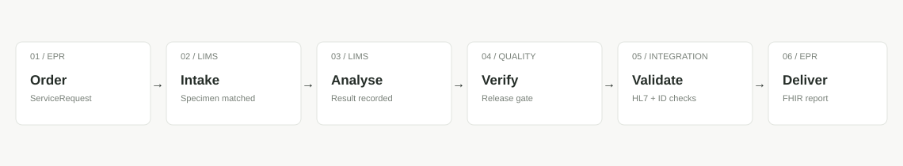

# Genflow — Laboratory integration workbench

**An independent, interactive healthcare interoperability portfolio project by Vincent Olagbemide.**

**[Open the live workbench](https://vincentayorinde.github.io/nhs-lab-integration-demo/)** · [Read the source](https://github.com/vincentayorinde/nhs-lab-integration-demo)

> **Important:** Genflow is not affiliated with the NHS or Oxford University Hospitals. It uses fictional patients and test results. It is not an accredited LIMS, EPR, medical device, clinical decision-support system, or production-ready HL7/FHIR implementation. No real patient data is used.

## The idea

A clinician requests a genetic test in an Electronic Patient Record (EPR). A laboratory receives the specimen in a Laboratory Information Management System (LIMS), analyses it, verifies a result and communicates the result back to the EPR. Every handoff must preserve the correct patient, order and specimen identity. Genflow makes this journey understandable to clinical and technical audiences.



The experience follows a six-stage workflow:

| Stage | What actually happens in the workbench |
| --- | --- |
| 1. Order | Create a unique test order with synthetic patient and specimen identifiers; generate a FHIR R4-style `ServiceRequest` |
| 2. Receive | Require specimen receipt before processing |
| 3. Analyse | Start the laboratory workflow |
| 4. Review | Record a fictional result from a controlled catalogue |
| 5. Verify | Require a review step before release |
| 6. Deliver | Create an HL7 v2-style `ORU^R01`, reconcile identifiers, and map an `Observation` / `DiagnosticReport` |

The workbench also demonstrates:
- Creating multiple independent orders and selecting their states;
- Search, filtering and dynamic operational metrics;
- A chronological audit trail of every action and blocked handoff;
- A controlled failure scenario: inject a patient-ID mismatch, see the result blocked, then retry with corrected identity;
- An idempotency check that prevents processing a previously delivered message;
- A payload inspector showing the actual generated request, HL7 result message and FHIR-style resources;
- Browser-local persistence to keep state across page refreshes.

## Two working modes

### 1. GitHub Pages: interactive browser workbench

The **public hosted page** runs the actual JavaScript domain state machine, with its own validation, message transformations, audit data and browser-local persistence. It is not a screenshot or a pre-recorded animation. Data is local to each visitor's browser. **It has no remotely hosted database or NHS/EPR/LIMS connection.**

Open the live workbench and click **New test request**. Follow the case stages. Use **Message explorer** to inspect the payloads and **Audit trail** to inspect recorded events. On a verified case, enable **Inject a patient-ID mismatch** to demonstrate delivery blocking.

### 2. Local SQL Server mode: database-backed Node.js service

Run a real Node.js HTTP API with Microsoft SQL Server using Docker Compose. The same UI automatically detects the local API and switches to SQL Server-backed state. Mutations are executed server-side inside SQL transactions and saved to a persistent SQL Server database.

**Prerequisites:** Docker Desktop (x86_64 support or emulation for SQL Server 2022), Docker Compose and sufficient memory (at least 4 GB recommended).

```bash
cp .env.example .env
# Edit .env and choose a strong, unique MSSQL_SA_PASSWORD.
docker compose up --build
```

Open **http://localhost:8080**. Check **http://localhost:8080/api/health** to confirm the database connection. The SQL Server database and application API are bound to the local host and are **not suitable for public internet exposure**: there is no user authentication or production security layer.

Persistent database storage uses a transactional JSON document in `dbo.GenflowWorkspace` to keep this teaching project easy to operate. `sql/schema.sql` contains a separate, illustrative normalised laboratory schema for an expanded implementation; it is *not* the storage scheme currently used by the optional API.

## Architecture

```text
                        Synthetic clinician / EPR
                                  |
                           FHIR-style request
                                  |
          +-----------------------v-----------------------+
          |                 Genflow workbench             |
          |  Case management | workflow rules | audit     |
          |  specimen check  | verified releases         |
          +-----------------------+-----------------------+
                                  |
                             HL7 v2 ORU^R01
                                  |
                         Identity + duplicate checks
                                  |
                  FHIR Observation + DiagnosticReport
                                  |
                         Synthetic EPR destination

GitHub Pages: browser state -> localStorage
Docker mode: browser -> Node.js HTTP API -> Microsoft SQL Server
```

## Stack

- HTML, modern CSS and JavaScript ES modules (no UI framework required);
- Typed workflow concepts in reusable, testable JavaScript domain functions;
- HL7 v2 message construction/parsing of `MSH`, `PID`, `OBR`, `OBX` segments (**limited subset**);
- FHIR R4-style `ServiceRequest`, `Observation` and `DiagnosticReport` resource objects (**not validated against an official conformance engine**);
- Optional Node.js HTTP server with `mssql` and SQL Server 2022 Developer edition;
- Docker Compose for local infrastructure; GitHub Pages for public static hosting;
- Node.js built-in test runner.

## Run automated tests

```bash
npm test
```

Tests cover state progression, patient and specimen reconciliation, incomplete outcomes, release gates, duplicate delivery and the failure/retry path. The domain tests have no external dependencies or patient data.

## Repository layout

```text
api/server.mjs                 Optional SQL Server-backed local HTTP API
docs/index.html               Workbench shell and explanatory content
docs/style.css                Original light editorial interface design
docs/app.mjs                  UI interactions, persistence, API detection
docs/core.mjs                 Shared domain engine, HL7/FHIR-style mappings
docs/flow.svg                 Original architectural illustration
sql/schema.sql                Illustrative future normalized SQL Server schema
tests/integration.test.mjs    Domain tests
Dockerfile                    Local API container
docker-compose.yml            Local SQL Server + API services
```

## Honest limitations and next milestones

This project demonstrates engineering concepts and workflows, not verified healthcare interoperability compliance. The message parser accepts only a small educational subset of HL7 v2. No terminology service, HL7 escapes handling, resource profiling, FHIR validator, PKI, clinical safety case, NHS information governance assessment or live laboratory integration is provided. The audit log can be reset and should not be treated as tamper-evident.

A fuller production-oriented build would require standards-conformant HL7/FHIR validation, local NHS profiling, secure service-to-service transport, clinical governance, comprehensive message acknowledgements, retry/reconciliation queues, patient-identity matching procedures, and an accredited integration environment.

## References

- [FHIR R4 ServiceRequest](https://hl7.org/fhir/R4/servicerequest.html)
- [FHIR R4 Observation](https://hl7.org/fhir/R4/observation.html)
- [FHIR R4 DiagnosticReport](https://hl7.org/fhir/R4/diagnosticreport.html)
- [HL7 standards organisation](https://www.hl7.org/)

**Visual direction:** an original interface drawing from the clean typography, restrained colour, spacious layout and workflow-focused presentation seen in contemporary enterprise software. No HappyRobot branding, logos or assets are used.